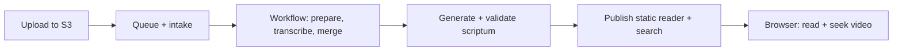

# What the spike means for the project plan

**Assessment date:** 8 November 2026, Europe/Vienna. Based on the [spike report](README.md), its [retained data](data/README.md), the [formal findings](../../docs/history/m1-fail-fast-spike.md), and the [scope/KPI baseline](../../docs/planning/scope-and-kpi-baseline.md).

**Recommendation:** continue with the serverless lecture-scriptum project, using the tested Groq models and AWS Lambda/S3 as the technical baseline. The spike removed the immediate access, integration and short-input packaging risks. Full-lecture quality, automation, reliability and the original performance KPIs remain unverified. Free-tier quotas already require changes to the peak-load evaluation plan.

This document proposes follow-up work; it does not authorize or execute another experiment. The spike resources have been deleted and the temporary Groq key revoked. All planned inference is complete.

## 1. What is now supported by evidence

| Finding | Meaning for the project | Boundary of the evidence |
| --- | --- | --- |
| A manual Lambda invocation read a private S3 MP4, called Groq ASR and the LLM, and saved Markdown/raw JSON. | The central media-to-notes integration works on the chosen Free Plan route. | One 55-second English educational clip; no upload trigger, workflow, reader or search. |
| `whisper-large-v3-turbo` returned 16 timestamped segments locally and in Lambda. | Keep it as the concrete transcription choice for the next stage. Timestamped source material is available for video links. | No measured WER, German evaluation, chunk-boundary evaluation or full-lecture test. |
| Groq `openai/gpt-oss-20b` returned three bullets locally and in Lambda. | Use this tested LLM as the planning baseline; another model is unnecessary for proving access. | Generation used at most the first 2,400 transcript characters. Chapters, key terms, long-context generation and source references were not tested. |
| Linux x86_64 FFmpeg ran in a Lambda layer and produced the required 16 kHz mono, 16-bit WAV. | Lambda remains a credible preprocessing candidate; no evidence currently requires another compute service. | Only 55 seconds extracted. The combined function/layer was 172,702,328 bytes; long-input resource use remains unknown. |
| Direct MP4 and extracted WAV produced matching cloud transcripts. | Use direct MP4 for small, supported inputs; retain extraction/chunking for larger recordings. | Two paths through the same clip do not establish general accuracy or format coverage. The WAV run reused the earlier bullets. |
| A cloud bullet introduced an unsupported elaboration. | Factual support must become an explicit acceptance criterion for the scriptum. | Successful requests and valid formatting do not establish trustworthy study material. |
| Both cloud runs were fast: 1.271 s and 1.825 s handler time. | There is no immediate short-input latency problem. | One run per path; initialization, queueing, publication and lecture-scale behavior are not represented by handler time alone. |

The [cloud results](02-cloud.md) and [FFmpeg results](03-ffmpeg-and-cleanup.md) contain the measurements. The three ASR submissions total **165 audio seconds**, but all use the **same 55-second excerpt**. This is integration evidence, not a representative evaluation dataset.

## 2. What should change in the big-picture plan

### Carry the tested technology choices forward

Use **Python 3.13 / x86_64, on-demand Lambda, private S3, Groq Free `whisper-large-v3-turbo`, and Groq Free `openai/gpt-oss-20b`** as the baseline. Use FFmpeg when audio preparation is needed. The tested HTTPS connection worked without a customer VPC, so the current plan has no demonstrated need for a NAT gateway.

Bedrock/Nova and Amazon Transcribe remain historical comparison options, with no successful inference evidence from this spike. Do not carry them into the selected architecture or its cost estimate by copying older diagrams. A provider change would need its own reason and validation.

Keep the product goal: an upload produces a structured, searchable scriptum with chapters, summary, key terms and links back to the recording. Three bullets prove one dependency, not that product. Chat, OCR and public uploads should remain outside the core implementation scope.

### Treat the rest of the architecture as proposed

The existing queue/workflow design remains a useful candidate:

Only the underlying S3/Lambda/Groq calls and short FFmpeg extraction were exercised. **S3 notifications, SQS, Step Functions, DynamoDB job/quota state, managed key retrieval and CloudFront publication remain untested here.** Use on-demand Lambda workers for the bursty prototype. Retain Step Functions Standard as the workflow candidate for visible stages, bounded retries and quota waits, subject to an access/integration check.

The broader [execution plan](../../docs/history/m1-execution-plan.md) proposes **SSM Standard SecureString** for the key. The spike used a temporary Lambda environment variable; it did not validate SSM retrieval. Treat that as an open dependency, and do not copy the older Secrets Manager cost assumptions into the revised estimate.

### Keep full-lecture support conditional

Groq currently documents MP4 support and a **25 MB Free-tier file limit**. Direct MP4 is therefore a useful short-input path, while larger recordings need a verified way to reduce and split their audio. [Groq speech documentation](https://console.groq.com/docs/speech-to-text)

For the tested PCM format, audio alone needs `16,000 samples/s × 2 bytes = 32,000 bytes/s`. This gives approximately **19.2 MB for ten minutes** and **172.8 MB for ninety minutes**, before headers. Four-minute chunks would be approximately **7.68 MB** each, making them a reasonable starting hypothesis, not a validated optimum.

The candidate **90-minute / 1 GiB MP4 limit** remains provisional. A 1 GiB source plus extracted audio cannot all fit in the spike's 1 GiB temporary storage configuration. Benchmark downloads, extraction, chunk uploads and cleanup together. The selected on-demand Lambda worker has a **15-minute invocation ceiling** and a **250 MiB combined uncompressed ZIP/layer limit**; input duration is not the same as execution duration. [Lambda quotas](https://docs.aws.amazon.com/lambda/latest/dg/gettingstarted-limits.html)

### Make output grounding part of the design

Require generated sections to refer to existing transcript segment IDs, then derive video times from those IDs in application code. Check structure, references and timestamp bounds before publication. Separately review whether each factual claim is actually supported: a valid segment ID does not prove factual fidelity.

The saved cloud bullets are a useful regression example because their unsupported wording is already known. Preserve the raw outputs unchanged. Tightening a prompt or validating JSON alone would not establish that the quality problem is solved.

## 3. What the findings mean for the KPIs

The [submitted targets](../../docs/planning/scope-and-kpi-baseline.md) remain hypotheses unless explicitly revised in Assignment 2.

| Target | Current assessment | Required evidence or revision |
| --- | --- | --- |
| WER <15% | Unverified. Matching MP4/WAV transcripts can share the same errors. | Compare against independently verified reference text; compare whole-input and chunked results using the same normalization. |
| p95 <30 min for a 90-min lecture | Unverified. | Measure upload event to retrievable scriptum, including quota waits, retries, generation and publication. Do not extrapolate from 55 seconds. |
| Five simultaneous lectures: p95 <1.5× single-lecture time | A major quota conflict for five 90-min lectures. | Revise the workload/target explicitly or record it as unattainable under the selected free capacity. Test shorter bursts separately. |
| ≥5× speedup at n=10, <10% extra cost | Unverified and potentially provider-limited. | Use fixed chunks at n=1,2,5,10,20; record global throttling, transcription time, end-to-end time and cost separately. |
| <€1 per lecture hour | Unverified; no immediate cost blocker observed. | Reprice the selected Groq/Groq architecture and measure all processing stages. Separate metered reference cost, free allowances and signup credits. |
| Idle compute <€1/month | Plausible design goal, unmeasured. | Inventory retained resources and idle activity; report storage/database costs separately. |

The recorded Groq organization limits were **7,200 audio seconds/hour and 28,800/day**: two audio hours/hour and eight/day. Five 90-minute lectures require **7.5 audio hours before overlap or retries**, exceeding one hourly allowance and consuming most of a daily allowance. Increasing Lambda concurrency cannot increase that capacity. Queueing protects the system but adds visible latency. Limits are shared across the organization; recheck actual limits before future experiments. [Groq rate limits](https://console.groq.com/docs/rate-limits)

For the selected LLM, the observed allowance was **8,000 tokens/minute and 200,000/day**. A model's context window does not guarantee that a full transcript fits the organization's request/token allowance. Budget section requests, repeated context and output tokens; evaluate lecture-wide generation separately from the three-bullet probe.

AWS's reported **estimated $0 before credits** was a billing snapshot with lag. It does not measure cost per lecture hour, establish idle cost or justify scaling the older four-month estimate unchanged.

## 4. Next feasibility checks, in order

Start with retained evidence and offline checks. Run live checks only in a separately authorized follow-up; the unused spike allowance is not permission to continue inference.

### A. Reconcile the plan and define evaluation inputs

**Do now without new inference:**

- Use the completed report as the current M1 evidence. The [planning workflow](../../docs/planning/project-planning-workflow.md), [Groq proposal](../../docs/research/groq-project-overview.md), [broader execution plan](../../docs/history/m1-execution-plan.md) and [access-results template](../../docs/history/m1-access-results.md) contain stale pending status, model choices or superseded setup requirements. Revise them when drafting the project plan.
- Choose the evaluation language and a small permitted dataset with verified transcripts. If German is claimed, include German examples. The retained 55-second clip's permission basis does not establish permission to reuse an entire lecture.
- Define a grounding rubric, timestamp tolerance and chunk-boundary checks before generating more results. Manually inspect the retained transcript/bullets and prepare expected examples for the renderer and validator.
- Define each remaining check's owner, bounded input/call allowance, evidence to retain, fallback and deadline. AWS operations remain owner-only; assigning local development work does not require inviting students to the AWS project.

**Pass condition:** one consistent technology baseline, a reproducible evaluation specification, and no deferred dependency presented as tested.

### B. Prove that representative media fits the worker

**Next authorized media check:** benchmark a permitted 5–10-minute recording, then a representative 90-minute recording, initially **without ASR or LLM calls**. Measure download/extraction/upload time, peak memory, temporary disk use, actual chunk sizes and package size. Verify manifest offsets and complete audio coverage; retain the selected binary's provenance and recorded GPL v3-or-later license information for the packaging review.

**Proposed pass condition:** the declared maximum input fits the selected on-demand worker with headroom, all requests can stay below the provider file limit, and chunks can be merged without missing or repeating boundary content. A repeated short clip may test plumbing but cannot establish realistic lecture quality or codec coverage.

**If it fails:** first reduce the declared input limit or revise extraction/storage handling. Another compute service is a separate feasibility and cost decision, not an automatic deployment fallback.

### C. Validate transcription and useful, grounded study material

**Next authorized inference check:** compare whole-input and chunked ASR on the same short reference recording. Measure WER and inspect opening/middle/end timestamps plus chunk boundaries. Then test longer input and German if those are part of the claim. Reuse saved transcripts for LLM-only work.

Generate a small structured scriptum with chapters, summary, key terms and segment references. Include a case ending mid-sentence, reflecting the retained excerpt's boundary. Review coverage and factual support, not just whether the model returns JSON.

**Pass condition:** the WER target is met or explicitly revised, source links meet the chosen tolerance, and the reviewed sample contains no unsupported factual additions. Longer generation must also fit the actual token quotas and finish without truncation. These are proposed acceptance criteria, not spike results.

**If it fails:** narrow the language/input scope, improve segmentation or prompts, or use provided verified captions/extractive notes as an explicitly reduced-scope fallback. Captions would not verify the ASR KPI.

### D. Prove one automatic workflow and its failure paths

Deploy the smallest reproducible candidate stack in **eu-north-1**, initially using the archived responses or a provider stub. Check upload notification → intake → workflow → artifacts/status, plus SSM key retrieval. Exercise SQS/DynamoDB only as required by the retained design; record successful access separately from functional correctness.

Inject duplicate upload events, corrupt media, a mocked `429`, a timeout, and failure after ASR succeeds but before its result is saved. Check stage-level recovery, attempt accounting, bounded retries, terminal failure records and reservation release. An uncertain external-call outcome must not cause an uncounted resubmission. S3 notifications use at-least-once delivery, so duplicate handling is required. [S3 event notifications](https://docs.aws.amazon.com/AmazonS3/latest/userguide/EventNotifications.html)

**Pass condition:** one upload reaches a complete result; duplicates reuse the logical job and completed stages; injected errors recover or terminate clearly without uncontrolled provider calls. The spike's fixed-run attempt markers alone do not establish these properties.

### E. Check the student-facing path, then capacity

First serve a static page built from retained data. Verify playback, timestamp seeking, keyword search across at least two lecture entries, progress/error display and safe rendering. If CloudFront/S3 is retained, probe HTTPS delivery and origin permissions. A private origin does not itself restrict viewer access; use only permitted demonstration content for a public reader.

Next test shared quota admission and concurrent completion with mocked provider responses. Check that simultaneous publication preserves all catalog entries. Only then run a bounded real-provider concurrency experiment, scheduled across quota windows.

**Pass condition:** the browser supports the promised reading/search/navigation flow; capacity is enforced across workflows; failures do not leak reservations; concurrent completions do not lose published entries. Mocked timing demonstrates control logic only, not real ASR speedup or p95 latency.

## 5. Submission and implementation priorities

For the **23 November 2026** project-plan submission, use the [requirements checklist](../../docs/planning/project-plan-checklist.md): select the tested model pair, provide an explained target architecture diagram, distinguish proven components from open risks, update the cost basis, and justify any scope/KPI changes. The detailed plan is limited to ten pages; this evidence summary is supporting material.

Complete the offline reconciliation first. Prioritize media fit and output quality in the next authorized feasibility work, alongside small supporting-service probes if possible. Full integration and statistically useful KPI measurements can follow during the eight implementation weeks. Any deferred architecture risk needs a named owner, an early implementation deadline and a fallback; it must not be hidden by marking the entire M1 complete.

Keep the two planned experiments focused:

1. **Quality, latency and cost:** reference transcripts, whole/chunked comparisons, grounding review, timestamp checks, and short-to-90-minute processing measurements. Record stage times and end-to-end time separately.
2. **Concurrency and backpressure:** fixed chunks at n=1,2,5,10,20 and a clearly specified five-upload workload. Include queue/provider waiting in user-visible latency. Predeclare repetitions within the approved budget and report sample sizes; isolated successful runs cannot establish p95.

## 6. Boundaries for all follow-up work

- Keep AWS and Groq on their free plans; no paid upgrade. Application resources stay in **eu-north-1**; AWS CLI commands use **`--profile studynotes`**. Retain the manual **$1 AWS usage stop before credits**. The $0.50 alert and team-access checks remain intentionally out of scope.
- The existing campaign remains at **165 audio seconds / 2 LLM calls**, leaving **435 seconds / 1 call**. Do not reset its ledger or silently treat the remainder as a new allowance. Long-lecture and repeated experiments need an explicitly agreed follow-up budget and fresh temporary credentials.
- Recheck plan/usage status before future live work and billing after its reporting refresh. Export results before cleanup and record whether new resources are to be retained or removed. The recorded AWS Free Plan end is **8 May 2027 (Vienna time)**, independently of later credit expiry.
- Preserve the entire [data archive](data/README.md), its attribution and manifest, the report and the [cleanup receipt](aws-cleanup.json). No new inference or resource deployment was performed to write this assessment.
