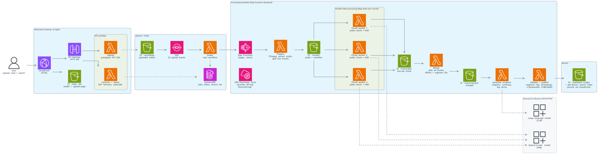

# Lecture scriptum generator: architecture

**Status:** proposed target architecture, 13 November 2026. It builds on the [M1 spike](../README.md) and the [project-plan assessment](../05-project-plan-and-feasibility.md). Only the parts marked *tested* in [section 13](#13-tested-vs-proposed) actually ran in the spike; everything else is a design that still needs to be built and checked.

## 1. What the application does

A serverless application turns each lecture recording into a **scriptum**: a written, structured version of the lecture in which every passage links back to the matching minute in the video.

It reacts to two kinds of events:

- **Video upload.** Uploading a lecture video starts a processing workflow:
  1. extract the audio and split it into chunks;
  2. transcribe the chunks in parallel, then merge them into one timestamped transcript;
  3. let an LLM structure the transcript into chapters, a summary and key terms;
  4. publish the finished scriptum as a static web page, with no running server.
- **Student request.** Students open the scriptum in the browser, search for keywords across all lectures and jump straight to the matching passage in the video.

## 2. Architecture at a glance

Source: [architecture-project.puml](architecture-project.puml), drawn with the official AWS icons ([AWS Icons for PlantUML v23.1](https://github.com/awslabs/aws-icons-for-plantuml)). Render with `plantuml -tsvg architecture-project.puml` (needs network for the icon includes).

The diagram reads left to right: **user → web → upload + intake → processing workflow → results**, with the external AI models below the workflow.

Not yet drawn: **video delivery to the browser** (CloudFront serving the recording for playback, [section 6.3](#63-play-the-video-and-jump-to-a-passage)). It is part of the design; the diagram should get a CloudFront → recordings arrow.

The spike itself is drawn separately: [architecture.puml](../architecture.puml) (detailed) and [architecture-flow.puml](../architecture-flow.puml) (overview).

## 3. Components

### Web (static hosting, no login)

| Component | Service | What it does |
| --- | --- | --- |
| CloudFront | Amazon CloudFront | Single HTTPS entry point. Serves the site, the published scripta, the videos and (optionally) the API |
| S3 · static site | Amazon S3 | HTML, JavaScript and CSS of the reader and upload page |
| API Gateway | API Gateway HTTP API | HTTP endpoints for the page |
| Upload Lambda | AWS Lambda | Returns a short-lived presigned URL so the browser uploads the video straight to S3 |
| Lectures + status Lambda | AWS Lambda | `GET /lectures` (published lectures) and `GET /jobs/{id}` (processing progress), both read from DynamoDB |

### Upload + intake

| Component | Service | What it does |
| --- | --- | --- |
| S3 · recordings | Amazon S3 | Uploaded videos, plus each job's in-between files under `jobs/{id}/` |
| SQS | Amazon SQS | Buffers the "new upload" events from S3 |
| Intake Lambda | AWS Lambda | Turns one upload event into one workflow run |
| DynamoDB | Amazon DynamoDB | Job records, processing status and the lecture list |

### Processing workflow (Step Functions Standard)

| Component | Service | What it does |
| --- | --- | --- |
| Step Functions | AWS Step Functions (Standard) | Runs the steps in order, runs the chunk workers in parallel, retries failures |
| SSM Parameter Store | AWS Systems Manager | Holds the AI provider's API key as a SecureString |
| Prepare Lambda | AWS Lambda + FFmpeg layer | Extracts the audio and splits it into chunks |
| S3 · chunks/ | Amazon S3 | Audio chunks plus a manifest listing them |
| Chunk workers 1…n | AWS Lambda (Map state) | Each sends one chunk to the speech-to-text model |
| S3 · transcripts/ | Amazon S3 | One transcript per chunk |
| Merge Lambda | AWS Lambda | Joins the chunk transcripts, shifts timestamps, numbers the segments |
| S3 · transcript.json | Amazon S3 | The full merged transcript |
| Generate scriptum Lambda | AWS Lambda | Asks the LLM for chapters, summary and key terms |
| Validate + publish Lambda | AWS Lambda | Checks references and timestamps, publishes, marks the lecture `PUBLISHED` in DynamoDB |

### Results

| Component | Service | What it does |
| --- | --- | --- |
| S3 · published scripta | Amazon S3 | Finished scripta and each lecture's search index, served via CloudFront |

### External AI inference API (HTTPS)

| Component | What it does |
| --- | --- |
| Speech-to-text model (ASR) | Turns an audio chunk into text with segment timestamps |
| Large language model (LLM) | Turns the transcript into chapters, summary and key terms |

The diagram keeps the provider generic. The spike tested **Groq** with `whisper-large-v3-turbo` (ASR) and `openai/gpt-oss-20b` (LLM); the cost estimate in [section 12](#12-cost-estimate) uses their prices.

## 4. Flow 1: video upload → published scriptum

1. **Ask for an upload link.** The upload page calls the API. The Upload Lambda checks the request (MP4, size), picks a lecture ID and returns a presigned URL for `videos/{lectureId}.mp4`, valid for a few minutes. The title can travel as object metadata.
2. **Upload.** The browser sends the video directly to the private recordings bucket. No Lambda handles the video bytes.
3. **Event.** S3 emits an `ObjectCreated` event, filtered to `videos/*.mp4`, into SQS. The filter matters: the workflow writes its own files into `jobs/` in the same bucket, and those must not trigger new jobs.
4. **Intake.** The Intake Lambda reads the event, creates the job item in DynamoDB and starts one Step Functions execution with `{lectureId, bucket, key}`.
5. **Prepare.** FFmpeg extracts mono 16 kHz audio and splits it into ~4-minute chunks. Chunks and a manifest go to `jobs/{id}/chunks/`.
6. **Transcribe in parallel.** A Map state starts one chunk worker per manifest entry. Each worker sends its chunk to the ASR model and saves the result to `jobs/{id}/transcripts/`.
7. **Merge.** When every chunk is done, Step Functions starts Merge, which builds `jobs/{id}/transcript.json` with lecture-wide timestamps and segment IDs.
8. **Generate.** The LLM structures the transcript into chapters, a summary and key terms, referring to segment IDs.
9. **Validate + publish.** The result is checked, timestamps are filled in from the segment IDs, and the lecture's files are written to the published bucket. Finally the lecture is marked `PUBLISHED` in DynamoDB.
10. **Visible.** The next `GET /lectures` call includes the new lecture.

Every stage writes its progress (`stage`, `status`) to DynamoDB, so `GET /jobs/{id}` can show it on the upload page.

## 5. Inside the processing workflow

### 5.1 State machine

~~~mermaid
flowchart LR
    S(["Start: lectureId, key"]) --> P[Prepare]
    P --> M{{"Map: TranscribeChunk × n"}}
    M --> G[Merge]
    G --> L[Generate scriptum]
    L --> V[Validate + publish]
    V --> E(["PUBLISHED"])
    P & M & G & L & V -.->|error after retries| F["Mark FAILED in DynamoDB"]
~~~

Each step retries on temporary errors. If a step still fails, a `Catch` routes the run to a small step that records `FAILED`, the failed stage and the error type in DynamoDB.

### 5.2 Parallel transcription: how the workers hand over to Merge

The chunk workers **never call Merge**. Step Functions coordinates, and S3 holds the in-between results:

1. Prepare returns the manifest: one entry per chunk, e.g. `{index: 7, key: "jobs/abc/chunks/007.wav", startSec: 1680}`.
2. The **Map state** starts one worker per entry. `MaxConcurrency` caps how many run at once, so the provider's rate limits are respected.
3. Each worker writes its transcript to `jobs/{id}/transcripts/007.json` and returns only a **pointer**: `{index: 7, key: "…/007.json", startSec: 1680}`.
4. The Map state finishes **only when all workers have succeeded**. It collects the pointers into an array, **in input order**, regardless of which worker finished first.
5. Step Functions then starts **Merge** as the next state and hands it that array. Merge never polls or counts; it simply runs next.

~~~json
"TranscribeChunks": {
  "Type": "Map",
  "ItemsPath": "$.manifest.chunks",
  "MaxConcurrency": 5,
  "ItemProcessor": {
    "ProcessorConfig": { "Mode": "INLINE" },
    "StartAt": "TranscribeChunk",
    "States": {
      "TranscribeChunk": {
        "Type": "Task",
        "Resource": "arn:aws:states:::lambda:invoke",
        "Parameters": { "FunctionName": "chunk-worker", "Payload.$": "$" },
        "OutputPath": "$.Payload",
        "Retry": [{ "ErrorEquals": ["RateLimited"], "IntervalSeconds": 30,
                    "BackoffRate": 2, "MaxAttempts": 5 }],
        "End": true
      }
    }
  },
  "ResultPath": "$.chunkResults",
  "Next": "MergeTranscript"
}
~~~

**Why S3 and not the workflow state:** Step Functions allows at most **256 KiB** of data per state. A 90-minute lecture has ~23 chunk transcripts with segment timestamps, which can exceed that. Lambda's `/tmp` is private to one execution environment, so other workers and Merge cannot see it. Only S3 keys travel through Step Functions.

An *inline* Map runs up to 40 iterations at once, which is plenty for ~23 chunks; a *distributed* Map is not needed.

### 5.3 Prepare

- Download the video to `/tmp` (configurable up to 10 GB), or let FFmpeg read it directly from a presigned HTTPS URL to save space.
- Extract audio: mono, 16 kHz, 16-bit PCM WAV, the format tested in the spike:

  ~~~text
  ffmpeg -i input.mp4 -map 0:a:0 -vn -ac 1 -ar 16000 -c:a pcm_s16le -f segment -segment_time 240 chunk_%03d.wav
  ~~~

- Audio needs 32,000 bytes per second, so a **4-minute chunk is ~7.68 MB**, below the provider's 25 MB per-file limit.
- Write the chunks and a manifest with each chunk's index, key, start and end time.

### 5.4 Chunk worker

- **Check first, then call:** if `transcripts/{index}.json` already exists, return its pointer without calling the model. A retry or a duplicate run then never pays twice. The spike used the same idea with S3 "create only if missing" writes (`If-None-Match: *`) for its `attempts/` markers.
- Read the API key from SSM (cache it for the lifetime of the Lambda instance).
- Send the chunk to the ASR model with segment-level timestamps; save the raw response.
- On a rate-limit response (HTTP 429) raise `RateLimited`, so Step Functions waits and retries.

### 5.5 Merge

- Read the chunk transcripts in manifest order.
- Shift every segment's start and end by its chunk's `startSec`, so times are relative to the whole lecture.
- If chunks overlap slightly (to avoid cutting words), drop the repeated text at the boundaries.
- Number all segments lecture-wide (`s0001`, `s0002`, …) and write `transcript.json`.

### 5.6 Generate scriptum

- Send the transcript as segment-tagged text (`[s0042] …`) and ask for structured JSON: chapters (title, first and last segment, summary), an overall summary and key terms, each pointing to segment IDs.
- The prompt treats the transcript as source data and tells the model to ignore instructions inside it (as in the spike's handler).
- Save the raw LLM response and the draft to `jobs/{id}/`.
- **Long lectures:** a 90-minute transcript is roughly 13,500 words (~18,000 tokens). The free tier recorded during the spike allows **8,000 tokens per minute**, so long lectures need to be processed in parts (e.g. chapter by chapter) or across several minutes. Still to be tested.

### 5.7 Validate + publish

- Check the JSON structure; check that every segment ID exists, chapters are in order and inside the lecture's duration.
- **Timestamps come from the segment IDs in code, never from the LLM.**
- Write the lecture's files to the published bucket first, then mark the lecture `PUBLISHED` in DynamoDB, so the list never points to missing files.
- Valid references do not prove the text is true. The spike's cloud bullets added "algorithmic manipulation", which the excerpt never said; keep that output as a regression example and review a sample of results by hand.

## 6. Flow 2: student request

### 6.1 Find the lectures

The page calls `GET /lectures`. The Lectures + status Lambda queries DynamoDB for all items with `status = PUBLISHED` and returns title, date, duration, key terms and the path of each lecture's files.

**Why DynamoDB + API and not a `catalog.json` file:** a static catalog file would have to be rewritten whenever a lecture is published. Two lectures finishing at the same time could then overwrite each other's entry, and CloudFront might serve a stale copy. Reading the list from DynamoDB avoids both problems: each lecture is its own item, and the list is always current. The page itself stays static; only the list comes from the API. Cost: the lecture list depends on API Gateway + Lambda, and a cold Lambda adds a few hundred milliseconds (a short CloudFront cache on the API, e.g. 30–60 s, hides most of it).

### 6.2 Open a scriptum

The page loads `lectures/{id}/scriptum.json` through CloudFront and renders chapters, summary and key terms. Each passage shows its time and links to it.

### 6.3 Play the video and jump to a passage

The reader page uses the browser's `<video>` element. Clicking a passage sets `video.currentTime` to the passage's start (and the URL can carry it, e.g. `?lecture=ws26-ana-03&t=1680`).

For that, CloudFront must serve the video:

- **Recommended:** a second CloudFront origin on the recordings bucket, limited to `videos/*` and using Origin Access Control. CloudFront and S3 support HTTP range requests, so seeking works without downloading the whole file, and the video is not stored twice (a 90-minute lecture can be close to 1 GiB; the S3 free tier is 5 GB).
- **Alternative:** copy the video into the published bucket during publish. Simpler, but doubles storage.
- Browsers only play common formats, so **require MP4 (H.264/AAC) uploads**. Converting a 90-minute video would likely not fit Lambda's 15-minute limit.

### 6.4 Search all lectures

DynamoDB cannot search text, so search runs **in the browser**:

- Each lecture publishes its own `lectures/{id}/search.json` (segment ID, start time, text). No file is shared between lectures, so parallel publishing cannot conflict.
- The page gets the list from `GET /lectures`, loads the per-lecture search files and indexes them with a small library such as MiniSearch.
- A hit shows the lecture, the passage and its time; clicking it opens the lecture and seeks the video there.
- Scale: a 90-minute transcript is roughly 80–100 KB of JSON before compression, so tens of lectures load comfortably. A combined, prebuilt index can be added later if needed.

### 6.5 Suggested CloudFront paths

| Path | Origin |
| --- | --- |
| `/` | S3 static site (reader, upload page) |
| `/lectures/*` | S3 published scripta (immutable files, long cache) |
| `/videos/*` | S3 recordings, videos only (range requests) |
| `/api/*` | API Gateway (no or short cache; same origin, so no CORS setup) |

## 7. Data layout

### 7.1 S3 keys

~~~text
recordings bucket (private)
  videos/{lectureId}.mp4                 uploaded video (triggers processing)
  jobs/{lectureId}/chunks/000.wav …      audio chunks
  jobs/{lectureId}/chunks/manifest.json  chunk list with start/end times
  jobs/{lectureId}/transcripts/000.json  one ASR result per chunk
  jobs/{lectureId}/transcript.json       merged transcript with segment IDs
  jobs/{lectureId}/llm.json, draft.json  raw LLM response, scriptum draft

published bucket (private, read via CloudFront)
  lectures/{lectureId}/scriptum.json     chapters, summary, key terms, times
  lectures/{lectureId}/transcript.json   segments for the reader
  lectures/{lectureId}/search.json       search data for this lecture

static site bucket (private, read via CloudFront)
  index.html, app.js, style.css
~~~

A lifecycle rule can delete `jobs/` after a few days to keep storage low. The published bucket and static site may also be one bucket with two prefixes.

### 7.2 DynamoDB

One item per lecture (lecture ID = job ID):

~~~json
{
  "pk": "LECTURE#ws26-ana-03",
  "status": "PUBLISHED",
  "stage": "done",
  "title": "Vectors, part 1",
  "date": "2026-11-20",
  "sourceKey": "videos/ws26-ana-03.mp4",
  "sourceETag": "9b2c…",
  "durationSec": 5400,
  "chunks": 23,
  "keyTerms": ["vector", "basis", "span"],
  "path": "lectures/ws26-ana-03/",
  "updatedAt": "2026-11-20T14:03:11Z"
}
~~~

- `GET /jobs/{id}` reads one item.
- `GET /lectures` queries a secondary index with `status` as partition key and `date` as sort key. (At tens of lectures, a scan would also work.)
- Only details and S3 paths go into DynamoDB, never transcript text (400 KB item limit).

### 7.3 What travels through Step Functions

Only small JSON: lecture ID, S3 keys, the chunk manifest (index, key, start/end) and per-chunk pointers. All media and text live in S3.

## 8. Reliability

| Concern | Handling |
| --- | --- |
| **Duplicate events** | S3 delivers events *at least once*, and a file may be uploaded twice. Intake creates the job item with a conditional write (only if it does not exist yet) and names the execution after the lecture ID; Standard workflows reject a second execution with the same name (names stay reserved for 90 days). Duplicates are skipped. |
| **Temporary errors** | Step Functions `Retry` with backoff per step; `RateLimited` (HTTP 429) gets longer waits. |
| **Paying twice** | Workers check for an existing result before calling the model. An uncertain call (e.g. a timeout) is counted, not silently re-sent. |
| **Permanent errors** | `Catch` → record `FAILED`, the stage and error type in DynamoDB; the upload page shows it. |
| **Partial output** | Publish writes files first, then marks `PUBLISHED`. |
| **Logs** | CloudWatch Logs with status and timings only: no API key, no request bodies (as in the spike). |

## 9. Security

- All buckets private (Block Public Access on), SSE-S3 encryption, bucket policy that denies non-TLS requests (as in the spike).
- CloudFront reads the buckets through Origin Access Control; nothing is public in S3 itself.
- Uploads only via short-lived presigned URLs. A presigned **POST** can additionally enforce a maximum file size.
- The provider API key lives in SSM Parameter Store (SecureString), never in code or logs.
- One IAM role per Lambda with only the actions and keys it needs (the spike's role allowed exactly one GetObject path and two PutObject prefixes).
- **Open decision:** the site has no login, but the plan keeps public uploads out of scope. The upload endpoint therefore needs some protection, e.g. a Lambda authorizer that checks a shared upload token, or uploads only by the team.

## 10. Technology stack

| Area | Choice |
| --- | --- |
| Cloud | AWS, fully serverless, region **eu-north-1** (Stockholm), AWS Free Plan |
| Backend language | **Python 3.13** on Lambda, **x86_64** (matches the FFmpeg build) |
| AWS SDK | boto3 (included in the Lambda runtime) |
| HTTP to the provider | Python standard library (`urllib`), as in the spike; no extra package needed |
| Media | **FFmpeg** static Linux build as a Lambda layer (spike: n9.0.2, GPL v3 or later; ~68 MB zipped, ~173 MB unpacked, uploaded via S3) |
| AI | External speech-to-text model + LLM over HTTPS (spike: Groq `whisper-large-v3-turbo`, `openai/gpt-oss-20b`) |
| Orchestration | AWS Step Functions **Standard**, inline Map for the parallel step |
| Data | Amazon S3 (files), Amazon DynamoDB on-demand (jobs, status, lecture list) |
| Messaging | Amazon SQS between S3 events and Intake |
| Web | Static HTML/JavaScript page, browser `<video>` player, in-browser search (e.g. MiniSearch) |
| Delivery | Amazon CloudFront in front of the site, the published files, the videos and the API |
| Secrets | SSM Parameter Store SecureString |
| Monitoring | CloudWatch Logs |
| Deployment | Infrastructure as code (proposal: AWS SAM), so the stack can be created and removed repeatably |

## 11. Limits and sizing

| Limit | Value | Consequence |
| --- | --- | --- |
| Lambda run time | 15 min | Prepare must handle the largest lecture well within it; test early |
| Lambda package | 250 MB unzipped, incl. layers | FFmpeg already uses ~173 MB |
| Lambda `/tmp` | up to 10 GB (spike used 1 GB) | A 1 GiB video plus audio does not fit in 1 GB; raise it or stream from S3 |
| Step Functions data | 256 KiB per state | Pass S3 keys only |
| Inline Map | up to 40 parallel iterations | Enough for ~23 chunks |
| DynamoDB item | 400 KB | Details only, no text |
| Provider file size (free tier) | 25 MB | ~4-minute WAV chunks (~7.68 MB) |
| Provider ASR quota (recorded at spike time) | 7,200 audio s/hour, 28,800/day | One 90-min lecture (5,400 s) per hour; about five per day. More parallel Lambdas do not raise this. |
| Provider LLM quota (recorded at spike time) | 8,000 tokens/min, 200,000/day | Long transcripts need to be processed in parts |

Chunk counts: a 10-minute lecture gives 3 chunks (4 + 4 + 2 min); a 90-minute lecture gives 23.

## 12. Cost estimate

For **one 10-minute video**, at list prices on 13 November 2026 (AWS eu-north-1 price list; the tested provider's model pages). Estimated by scaling the spike's measurements, not measured.

| Part | Usage | Price | Cost |
| --- | --- | --- | --- |
| Speech-to-text | 600 s of audio | $0.04 per audio hour | **$0.0067** |
| LLM | ~3,500 tokens in, ~2,000 out | $0.075 / $0.30 per M tokens | $0.0009 |
| Lambda | ~45 GB-s | $0.0000166667 per GB-s | $0.0008 |
| Step Functions Standard | ~25 state transitions | $0.000025 each | $0.0006 |
| S3 requests | ~25 writes, ~20 reads | $0.005 per 1,000 writes | $0.0001 |
| SQS, DynamoDB, API Gateway, SSM, logs | a few calls | | < $0.0001 |
| **Processing total** | | | **≈ $0.009 (about 1 cent)** |
| S3 storage | ~100 MB video + ~20 MB chunks | $0.023 per GB-month | ≈ $0.003 per month |

- About **6 cents per lecture hour**, far below the plan's target of under €1 per lecture hour.
- Speech-to-text is ~70% of the cost; all AWS services together are a fraction of a cent.
- **Paid today: $0.** The Lambda free tier (400,000 GB-s/month), 4,000 free Step Functions transitions, the provider's free tier and the AWS Free Plan credits cover it.
- Watching: each full view of a 100 MB video sends 100 MB through CloudFront; CloudFront's free allowance (1 TB/month) covers that.
- Costs rise with retries (each AI call is paid again), more or larger LLM passes, and storage of large videos.

Assumptions: ~100 MB video (720p); Prepare ~15–30 s at 1–2 GB memory (the spike extracted 55 s of audio in ~1 s); three workers ~5 s each at 512 MB; ~1,500-word transcript.

## 13. Tested vs proposed

| Part | Status | Evidence |
| --- | --- | --- |
| Private S3 bucket, TLS-only, SSE-S3 | **Tested** | [Cloud walkthrough](../02-cloud.md) |
| Lambda (Python 3.13, x86_64) reading S3, calling the AI API, writing results | **Tested** | Handler 1.271 s for a 55 s clip |
| FFmpeg layer: MP4 → 16 kHz mono WAV | **Tested** | 1.03 s for 55 s; [FFmpeg results](../03-ffmpeg-and-cleanup.md) |
| Speech-to-text with segment timestamps | **Tested** | 16 segments; MP4 and WAV gave the same transcript |
| LLM structuring | **Partly tested** | Three bullets from the first 2,400 characters; chapters/key terms/references not tested; one unsupported claim |
| Scoped IAM role, CloudWatch Logs | **Tested** | [Code appendix](../04-code.md) |
| CloudFront, API Gateway, S3 events → SQS, Step Functions, Map, DynamoDB, SSM | Proposed | Not run yet |
| Chunking, merging, long lectures, German, WER | Proposed | Not run yet |
| Static reader, search, video seeking | Proposed | Not run yet |

## 14. Left out of the diagram on purpose

| Item | Why it is not drawn | Status |
| --- | --- | --- |
| Dead-letter queue (DLQ) on SQS | Kept the diagram simple | Recommended in implementation: catches upload events that keep failing in Intake |
| Quota reservations and waits | Kept the diagram simple | Optional: a DynamoDB counter per time window that workers reserve before calling the model; if full, Step Functions waits and retries. Without it, rate limits are handled by retries on HTTP 429 alone |
| Deduplication | Label removed | Still needed, see [section 8](#8-reliability) |
| Publish → DynamoDB arrow | A right-to-left line disturbed the layout | Shown in the Validate + publish caption ("→ DynamoDB: PUBLISHED") |
| Video delivery (CloudFront → recordings) | Not drawn yet | Part of the design, see [section 6.3](#63-play-the-video-and-jump-to-a-passage) |
| `catalog.json` | Replaced by `GET /lectures` from DynamoDB | See [section 6.1](#61-find-the-lectures) |
| OpenSearch, Bedrock, Transcribe | Not selected | Search runs in the browser; the plan keeps the tested external models |

## 15. Open questions and next checks

From the [project-plan assessment](../05-project-plan-and-feasibility.md#4-next-feasibility-checks-in-order), in order:

1. **Media fit:** does a representative 90-minute recording fit Prepare (time, memory, `/tmp`, chunk sizes)? Test without AI calls first.
2. **Transcription quality:** word error rate against a verified reference; whole vs chunked; chunk boundaries; German if claimed.
3. **Useful, grounded scriptum:** chapters, summary and key terms with valid segment references and no unsupported claims; long transcripts within the LLM token limits.
4. **One automatic run end to end:** upload → intake → workflow → published lecture, including duplicates, a mocked 429, a timeout and a failure after ASR.
5. **Student path:** playback, seeking, search across at least two lectures, progress and error display, safe rendering.
6. **Decisions still open:** upload protection without login; maximum video length and size; MP4-only uploads; chunk length (4 minutes is a starting guess); whether quota reservations are needed.

## 16. Related files

| File | Content |
| --- | --- |
| [architecture-project.puml](architecture-project.puml) / [.svg](architecture-project.svg) | This architecture |
| [architecture.puml](../architecture.puml) / [.svg](../architecture.svg) | Spike, detailed |
| [architecture-flow.puml](../architecture-flow.puml) / [.svg](../architecture-flow.svg) | Spike, overview |
| [README.md](../README.md) | Spike result |
| [02-cloud.md](../02-cloud.md), [03-ffmpeg-and-cleanup.md](../03-ffmpeg-and-cleanup.md) | Spike walkthrough and measurements |
| [04-code.md](../04-code.md) | Tested handler, IAM and bucket policies, layer packaging |
| [05-project-plan-and-feasibility.md](../05-project-plan-and-feasibility.md) | What the spike means for the plan; KPIs; next checks |
| [data/README.md](../data/README.md) | Archived inputs and outputs of the spike |
