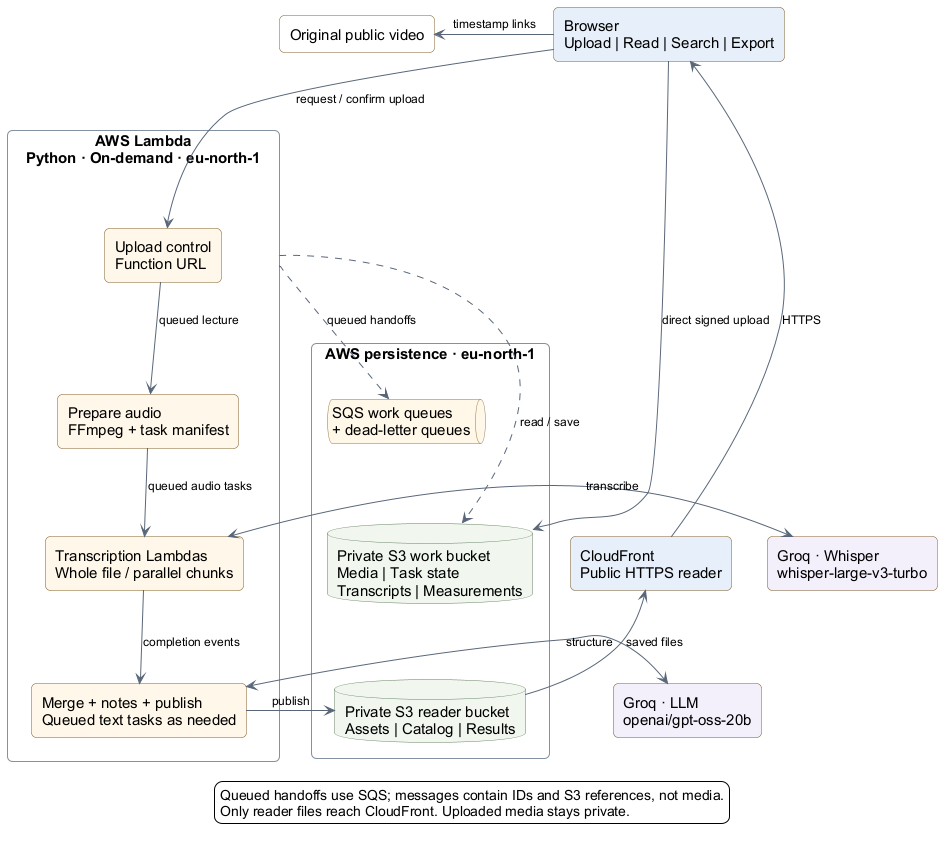

# StudyNotes — Planned AWS Architecture

*Figure 1. Queued Lambda processing with private S3 storage, Groq inference and a static HTTPS reader.*

## 1. Overview

StudyNotes will turn English lecture recordings into searchable, timestamped scriptums. The complete transcript will remain beneath generated chapters, an overview and key terms. Each passage will link to the original video's matching time.

**Browser → S3 upload → queued Lambdas → Groq transcription and notes → static reader.**

Regional AWS resources will use **Stockholm (eu-north-1)**. On-demand Lambda functions will perform individual processing tasks; SQS queues and S3 manifests will coordinate them. Parallel audio chunking will be compared with whole-file transcription. Most repeated tests will use ten-minute recordings; one complete 90-minute recording must also succeed.

## 2. Components and responsibilities

| Component | Role in this project |
| --- | --- |
| **Static reader — HTML/CSS/JavaScript** | Upload recordings with source metadata; read saved transcripts and notes; search across lectures; export Markdown; open original-video timestamps. Reading and searching will make no AI calls. |
| **Upload-control Lambda — anonymous Function URL** | Issue a short-lived S3 upload authorization, register metadata, verify the completed upload and queue its ID. The recording will go directly from the browser to S3. |
| **Private S3 work bucket** | Store recordings, prepared audio, task manifests, transcripts, processing state and benchmark records. Queue messages will contain references, not media. |
| **SQS queues + processing Lambdas — Python/FFmpeg** | Preparation will create audio tasks; separate transcription invocations will provide bounded parallelism. Completion events will trigger assembly. Merge/notes/publication functions will generate and publish the final artifacts. |
| **Groq Whisper — `whisper-large-v3-turbo`** | Transcribe each audio task into timestamped segments. This is the initial speech-model candidate. |
| **Groq LLM — `openai/gpt-oss-20b`** | Generate chapter boundaries, overview points and key terms referencing transcript segments. The model will not regenerate or replace the transcript. |
| **Private S3 reader bucket + CloudFront** | Store reader assets, catalog and per-lecture JSON; deliver them through public HTTPS using CloudFront origin access control. Pending status/catalog files will avoid long caching. Uploaded media will remain outside this origin. |

The group demo will have no application login. Scoped Lambda execution roles will access AWS resources. The Groq key will stay server-side in a Standard Parameter Store `SecureString`; CloudWatch and per-task receipts will record execution details. No database, API Gateway or dedicated workflow service is planned initially. [Private S3 origin](https://docs.aws.amazon.com/AmazonCloudFront/latest/DeveloperGuide/private-content-restricting-access-to-s3.html)

## 3. Processing flow

1. **Accept:** the browser obtains an upload authorization, sends the recording to S3 and confirms completion. The backend verifies the object and queues processing.
2. **Prepare:** FFmpeg extracts audio, validates media limits and creates a parent-lecture manifest containing task IDs and chunk offsets.
3. **Transcribe:** queued Lambdas reserve quota, call Groq and save results before sending completion events. Whole-file tests use one audio task; chunked tests use several.
4. **Assemble and structure:** merge available segments in order. Queue bounded text sections for notes when needed, then combine their structure into one lecture result.
5. **Publish:** validate references and save results. Calculate **video time = excerpt offset + chunk offset + local timestamp**. Display saved transcript content on partial failure, but record the run as incomplete.

Manifests will track success/failure for every task. Conditional S3 writes will protect task claims, final publication and concurrent catalog updates. The reader will load saved status/results and play the original public video. [Conditional writes](https://docs.aws.amazon.com/AmazonS3/latest/userguide/conditional-writes.html)

## 4. Technical limitations and planned handling

### 4.1 Upload, media preparation and Lambda limits

Ordinary Lambda synchronous invocation payloads are limited to **6 MB**, so video files will bypass Lambda and upload directly to S3. Short-lived signed POST policies will restrict the destination and accepted size; processing will start only after completion checks. [Lambda limits](https://docs.aws.amazon.com/lambda/latest/dg/gettingstarted-limits.html)

Each on-demand invocation must finish within **15 minutes**. We will measure preparation time, memory and temporary-disk requirements on representative files. FFmpeg will be packaged for the selected Linux runtime. If a full recording's preparation does not fit, evaluate separately extracting source time ranges in bounded tasks versus changing the accepted input encoding/size. Choose from elapsed time, repeated decoding/download cost and timestamp accuracy.

Groq Free permits **25 MB per audio file**. Ten minutes of 16 kHz mono PCM is approximately 19.2 MB; 90 minutes is approximately 173 MB. The long case therefore needs smaller audio files or compression. Start by evaluating several-minute chunks; compare compressed whole-file processing only when it fits. [Speech API](https://console.groq.com/docs/speech-to-text)

### 4.2 Shared quotas and concurrency

Groq's published Free limits currently include **20 ASR requests/minute, two audio hours/hour and eight audio hours/day**. GPT-OSS 20B lists **30 requests/minute, 8,000 tokens/minute and 200,000 tokens/day**. Actual organization limits must be checked before experiments; extra keys or Lambdas do not create more quota. [Groq limits](https://console.groq.com/docs/rate-limits)

We will combine dispatch/concurrency ceilings with shared S3 quota reservations using conditional updates. Deferred tasks will remain queued rather than sleeping inside Lambda. Explicit throttling will use the provider's retry delay and bounded retries. We will evaluate conservative pacing against utilization-based admission, choosing from queue delay, throttling, coordination overhead and achieved concurrency.

Five ten-minute uploads contain 50 audio minutes, which fits one published hourly audio allowance before retries/overlap. Repeated bursts still need scheduling. Quota availability does not establish the **<1.5× latency** target, and new AWS projects may have reduced Lambda concurrency quotas. [Lambda quotas](https://docs.aws.amazon.com/lambda/latest/dg/gettingstarted-limits.html)

### 4.3 Long transcripts and note generation

GPT-OSS 20B has a **131,072-token context window**, but the Free throughput allowance is much smaller. A large context window therefore does not make one full-lecture request practical. [Model specification](https://console.groq.com/docs/model/openai/gpt-oss-20b)

For long inputs, the initial plan is ordered text sections plus a final lecture-wide synthesis. Each request must fit the effective token allowance, including prompt and output headroom; calls will be paced across quota windows. One full-transcript request remains an option for shorter inputs where it fits. Select section size and synthesis strategy from coverage, factual support, consistency, latency and cost.

Structured JSON output will constrain the notes' shape. Code will still validate segment references, chapter order and coverage; schema compliance cannot establish factual correctness. [Structured outputs](https://console.groq.com/docs/structured-outputs)

### 4.4 Chunk boundaries, duplicates and failures

Longer audio chunks preserve context and reduce request overhead; shorter chunks expose more parallelism. We will test small overlaps, remove duplicated boundary text and preserve absolute offsets. Select chunk length/overlap from WER, timestamp accuracy, speed and total submitted audio.

SQS delivery can repeat. Stable IDs and conditional stage claims will prevent concurrent duplicate inference; saved responses will be reused. Ordinary uploads will deduplicate by file content, language and processing version. Basic retries will be bounded, terminal failures recorded, and exhausted messages retained in dead-letter queues. Uncertain external-call outcomes will stop for inspection. [SQS delivery](https://docs.aws.amazon.com/lambda/latest/dg/with-sqs.html)

Partial transcripts will preserve missing-range metadata. Advanced automatic recovery and user-facing recovery controls are outside the core.

## 5. Benchmarks and remaining risks

| Benchmark or risk | Planned treatment |
| --- | --- |
| **Parallel speedup** | Fix one chunk manifest; measure ASR-stage T(1)/T(n) for n = 1, 2, 5, 10, 20. Retain **≥5× at n=10 with <10% extra cost**. Include dispatch, queue and merge overhead; report actual concurrency. Compare whole-file processing separately. |
| **Peak load** | Repeat five simultaneous ten-minute uploads with matched serial inputs/settings. Retain **burst p95 / serial p95 <1.5**. Include quota waits and failures; distinguish provider throttling from Lambda scaling. |
| **Long input and quality** | Require one complete 90-minute result against the **<30-minute** goal, with checks late in the video. One success is not p95 evidence. Retain **English WER <15%** and compare chunked/whole-file accuracy. |
| **Cost and idle use** | Retain **<€1 per original audio hour** and **<€1/month idle compute**. Record all attempts, overlap, tokens, waiting invocations and storage operations. Report ordinary-price resource costs separately from free-tier payments/credits. No provisioned concurrency or always-on workers are planned. |
| **Benchmark validity** | Fix model versions, chunk settings and quota conditions; separate cold/warm trials. Explicit trial IDs will bypass ordinary deduplication. Incomplete output cannot pass complete-result latency targets. |
| **Funding, access and external dependencies** | Verify AWS credit/Free Plan expiry covers **19 January 2027**; export code and data before expiry. Groq model availability, quotas and note quality remain evaluation risks. Use permitted non-sensitive media because inference leaves AWS; original video links may disappear. |

The initial AWS Free Plan can last up to six months or credit exhaustion, whichever comes first. This supports a possible single-environment campaign; actual remaining funding and service access must be verified. [AWS plan terms](https://docs.aws.amazon.com/awsaccountbilling/latest/aboutv2/free-tier-plans.html)

## 6. Alternatives if the main candidates are unsatisfactory

- **Groq `whisper-large-v3` instead of Turbo:** evaluate if recognition quality remains inadequate, accepting additional processing cost/latency where measured. [Speech model comparison](https://console.groq.com/docs/speech-to-text)
- **Groq `openai/gpt-oss-120b` instead of 20B:** evaluate for better lecture-wide reasoning and note coverage if the smaller model disappoints. Compare quality, latency, reference cost and available quota; a larger model does not remove Free limits. [Model specification](https://console.groq.com/docs/model/openai/gpt-oss-120b)

## 7. Optional extensions — only after core benchmarks

- German transcription and a separate language-quality evaluation.
- Scriptum-grounded chat, including Assignment 1's **<€0.01/question** and **p95 <5 seconds at 50× traffic** targets; define normal traffic first.
- Slide-text OCR, as proposed in Assignment 1.
- Automatic restart/resume beyond basic retries; reconsider a workflow service only if recovery needs justify it.
