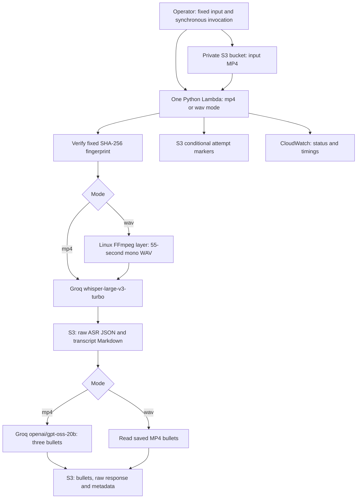

# Implemented AWS spike architecture

**Scope:** the retained implementation, as available on 13 November 2026. Its AWS resources are absent and its temporary Groq key is revoked. The local script, cloud-handler appendix and saved input/output files are available; the planned application is described [separately](aws-architecture-report.md).

## Components and flow

The arrows show calls made by the handler. S3 uploads do **not** trigger processing. There is no Function URL, API Gateway, SQS queue, Step Functions workflow, database, static reader or CloudFront distribution in this implementation.

The separate [local script](../groq_spike.py) exercises the Groq API from the operator's machine and records its attempts in the workspace campaign ledger. The [Lambda handler](../lambda_function.py), [layer/function packager](../package_layer.py), [upload helper](../../../projects/aws-groq-spike/upload.py) and [policy templates](../policies/README.md) are available as source beside these docs. The [cloud appendix](../04-code.md#lambda-handler) explains the tested handler and packaging/policy recipes.

## Actual configuration

| Component | Implemented configuration | Reason |
| --- | --- | --- |
| Region | `eu-north-1` (Stockholm) for application resources | The project's confirmed selected Region |
| Lambda | Python 3.13, x86_64, on-demand, one handler | A bounded task without an always-running service |
| Resource settings | 1,024 MB memory, 1,024 MB temporary storage, 300-second timeout | Enough for the fixed fixture; these settings do not establish full-lecture fit |
| Networking | No customer VPC; outbound HTTPS to Groq | The task does not require private network resources; no NAT gateway is part of the design |
| S3 | One private general-purpose bucket; ACLs disabled, Block Public Access enabled, SSE-S3 encryption and TLS-only policy | Retain media and results without exposing the bucket |
| Execution role | Scoped reads for the fixed input/saved bullets, writes under output/attempt prefixes, logging to the function's pre-created log group | Limit the worker to this experiment's resources |
| Secret | `GROQ_API_KEY` environment variable, entered by the operator | A temporary server-side credential; it is not saved in source or outputs |
| Logs | Pre-created CloudWatch log group, one-day retention | Retain diagnostics while limiting ongoing storage |
| FFmpeg | Linux x86_64 executable mounted at `/opt/bin/ffmpeg`, executable mode `0755` | The local Windows executable cannot run in Lambda |

The deployed resources and their configuration are recorded in the [cloud walkthrough](../02-cloud.md). Their identifiers are removal targets in the [cleanup receipt](../aws-cleanup.json), not active endpoints.

## Handler behavior

1. Accept only `{"mode":"mp4"}` or `{"mode":"wav"}`. Choose the fixed logical run `mp4-01` or `wav-01`.
2. Require the server-side key, read the fixed MP4 from S3 and verify its SHA-256 before submitting media.
3. In WAV mode, extract at most 55 seconds with FFmpeg: first audio track, mono, 16 kHz, signed 16-bit PCM. Check channel count, sample rate, sample width and duration.
4. Before each external inference request, create its S3 attempt marker with `If-None-Match: *`. An existing marker blocks repeated submission for that fixed run.
5. Submit English audio to `whisper-large-v3-turbo`, requesting verbose JSON and segment timestamps. Save the raw response and readable transcript before proceeding.
6. In MP4 mode, send at most the first 2,400 transcript characters to `openai/gpt-oss-20b`, asking for exactly three bullets with at most 1,024 completion tokens. In WAV mode, copy the already saved MP4 bullets and make no LLM call.
7. Save metadata and return a `pass` or `blocked` status. Logs contain selected status/timing fields. Inspect the returned status; an invocation HTTP 200 alone does not establish success.

The handler disables automatic service-request retries and rejects redirects for external HTTP calls. The experiment was invoked synchronously. Its conditional markers protect this fixed fixture from accidental repeat spending; they do not implement general upload deduplication or atomic transactions across S3 and Groq. If a call's outcome is uncertain, the marker remains and the run requires inspection.

## Why the spike is small

Manual invocation makes the external-call boundary explicit. A single worker isolates the media/storage/API connection without adding queue delivery, publication or workflow state. Raw responses are saved before rendering so they can be inspected and reused offline. Fixed media, hashes and run IDs make those integration checks reproducible.

Direct MP4 submission avoids an extraction dependency for supported small files. The separate WAV path checks Linux packaging and conversion, while reusing saved bullets avoids spending another LLM call on the same transcript. FFmpeg's combined uncompressed function/layer footprint was 172,702,328 bytes; the bundled binary reports GPL v3 or later. Reusing or distributing it requires a build/license review.

## What the implementation does not establish

| Limitation | Implication for the planned application |
| --- | --- |
| One fixed 55-second English input | No measured corpus WER, long-input quality, language coverage or load behavior |
| Three bullets from a bounded transcript excerpt | No complete-lecture chapters, key terms, coverage or validated source references |
| A saved cloud bullet adds unsupported detail | Factual support needs review beyond HTTP success and valid JSON |
| No queues, event intake or application job model | Delivery retries, shared quota admission, duplicate uploads and finalization still need implementation |
| No reader/publication stage | Search, export and source-video navigation remain planned |
| Manual usage ledger plus fixed S3 guards | No concurrent, application-wide accounting or general recovery guarantee |

The saved campaign contains 165 submitted audio seconds and two LLM calls, all using the same fixture. Its remaining allowance is not permission to run more calls. Inspect the [saved artifacts](../data/README.md) without rerunning the script. The [full-project brief](aws-architecture-report.md) and [open issues](aws-considerations.md) describe the work needed for the larger application.
